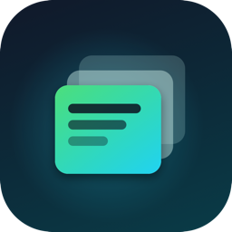

<p align="center">
  
</p>

<h1 align="center">ClipBar</h1>

<p align="center">
  <strong>Local-first clipboard manager for macOS</strong><br />
  Keyboard-first · Fast · Minimal · Private by default
</p>

<p align="center">
  <a href="README_CN.md">中文文档</a>
  ·
  <a href="https://github.com/BaaKoo9/ClipBar/releases">Download</a>
  ·
  <a href="https://github.com/BaaKoo9/ClipBar/releases/latest">Latest Release</a>
</p>

---

Summon with a hotkey, pick with arrow keys, paste with Enter — without leaving the keyboard.

<p align="center">
  
</p>

## Highlights

- **Snapshot bar** — horizontal cards with type filters and custom labels
- **Sequential paste** — enqueue, drag-reorder, reverse, or remove items in the side queue
- **Instant search** — keyword highlight; `#tag` jumps to a label
- **Local-first privacy** — clipboard history stays on your Mac (SQLite + media cache)
- **Zero third-party deps** — Swift + SwiftUI + AppKit only

<p align="center">
  
</p>

## Requirements

| | |
|---|---|
| macOS | **13 Ventura** or later |
| Chip | Separate Apple Silicon (arm64) and Intel (x86_64) builds; Intel support starts with v1.0.12 |
| Permissions | **Accessibility** + **Input Monitoring** (hotkeys & auto-paste); **Full Disk Access** recommended for file pasting |

## Install

Grab the latest build from [Releases](https://github.com/BaaKoo9/ClipBar/releases):

| Asset | Use when |
|---|---|
| **`ClipBar-x.y.z-arm64.pkg` / `.dmg`** | Apple Silicon: M1, M2, M3 and other M-series Macs |
| **`ClipBar-x.y.z-x86_64.pkg` / `.dmg`** | Intel Macs |

Double-click the PKG to install, or open the DMG and drag `ClipBar.app` into **Applications**. Each package has a matching `.sha256` file. Both builds require macOS 13 or later.

Starting with v1.0.12, in-app updates select only packages for the Mac's hardware architecture, preferring DMG with a same-architecture PKG fallback. An Intel build running under Rosetta on Apple Silicon migrates to the native ARM build. Automatic installation stops if a matching package or valid checksum is unavailable.

Starting with v1.0.12, all installers include an architecture suffix. Official releases through v1.0.11 contain ARM binaries only, and their updaters are not architecture-aware. A one-time manual upgrade using the `arm64` package is recommended; subsequent updates select the correct architecture.

### First open (not notarized)

Builds are self-signed and **not Apple-notarized**. If macOS blocks the first launch:

1. **Recommended**: Finder → **Control-click** ClipBar → **Open** → confirm **Open**
2. Or **System Settings → Privacy & Security** → **Open Anyway**

Then enable for ClipBar:

- Accessibility  
- Input Monitoring  
- **Recommended: Full Disk Access** to improve copying and pasting files in protected locations. Open System Settings → Privacy & Security → Full Disk Access, add and enable `/Applications/ClipBar.app`, then restart ClipBar. This is not required for text clipboard use.

### Re-authorize after replacing the signing certificate

Normal upgrades signed with the same identity keep these permissions. If ClipBar is rebuilt on another Mac with a new certificate, macOS treats it as a new code identity and the old permission records may no longer apply.

1. Quit ClipBar and make sure the only installed copy is `/Applications/ClipBar.app`.
2. Open **System Settings → Privacy & Security → Accessibility**, remove the old ClipBar entry instead of only toggling it off.
3. Do the same under **Input Monitoring**.
4. Install the newly signed build, then Control-click `/Applications/ClipBar.app` → **Open** for its first launch.
5. Add that exact App back to both permission lists, enable it, then quit and reopen ClipBar once.

If a stale entry still prevents authorization, reset only ClipBar's records in Terminal, relaunch it, and grant both permissions again:

```bash
tccutil reset Accessibility com.huxiaolong.ClipBar
tccutil reset ListenEvent com.huxiaolong.ClipBar
```

This does not delete clipboard history or settings. Do not remove `~/Library/Application Support/ClipBar` while repairing permissions.

## Quick start

| Action | Default shortcut |
|---|---|
| Summon / dismiss panel | `⌥⌘V` |
| Enqueue (copy selection + queue) | `⌥⌘E` |
| Dequeue paste | `⌥⌘D` |
| Select in panel | `←` `→` |
| Paste selection | `Enter` or click |
| Enqueue from panel | `⌘`-click or hover `⊕` |
| Activate search | Type immediately after opening the panel, or press `⌘F` |

All shortcuts are customizable in Settings.

<p align="center">
  
</p>

## Features

- Menu-bar resident; records text, links, images, files, and RTF
- Pin / favorite (excluded from capacity cleanup); optional bump-on-paste
- Dedup: identical content refreshes timestamp instead of stacking
- Labels: create, drag-reorder, edit/delete in panel; manage in Settings
- History limit + optional day-based retention (1–90 days, unpinned only)
- Ignore apps; launch at login; in-app update check with download progress
- About window with version and project link

> Clipboard **content** never leaves your machine. The optional updater only talks to GitHub Releases (with download mirrors) when you check for updates.

## Build from source

macOS 13+ with Xcode Command Line Tools (full Xcode not required):

```bash
./scripts/create-local-signing-identity.sh  # once per build Mac
./scripts/build-app.sh release arm64   # dist/arm64/ClipBar.app
./scripts/build-app.sh release x86_64  # dist/x86_64/ClipBar.app
./scripts/make-pkg.sh arm64           # use x86_64 for Intel
./scripts/make-dmg.sh arm64           # use x86_64 for Intel
./scripts/make-release-artifacts.sh   # both architectures and checksums, 8 assets
./scripts/install-local.sh release    # build and install the native architecture
./scripts/run-tests.sh          # core unit tests
```

Both architectures are cross-compiled with the macOS toolchain; Docker is not required. Packaging checks both executables and signs them with the same fixed identity. Interactive testing on an Intel Mac is still required.

The one-time setup creates a long-lived self-signed code-signing identity in
`~/Library/Keychains/clipboard-dev.keychain-db`. Release builds fail instead of
silently falling back to ad-hoc signing. Keep that keychain private. If a new
build Mac creates a replacement identity, users must follow the re-authorization
steps above once; later upgrades made with that same identity keep the permission.

## Tests

```bash
CLIPBAR_SKIP_SYSTEM_TESTS=1 ./scripts/run-tests.sh  # core regression tests
./scripts/run-tests.sh  # full tests; quit ClipBar first
```

Full tests temporarily write to the system clipboard and register a global shortcut, then restore the previous clipboard contents. Quit ClipBar before running them and reopen it afterward to keep test samples out of your history.

Covers insert/fetch, dedup, search, pin protection, clear, paste-back for text/image/file/RTF, hotkey registration, legacy DB migration, panel focus and dismissal policies, and a 10k-item performance check.

## Stack

- Swift + SwiftUI + AppKit — no SPM third-party packages
- SQLite (system): serialized writes, retention + history-limit cleanup
- Carbon global hotkeys + CGEventTap
- PNG storage + JPEG thumbnails; RTF preserved for rich text

## Roadmap

- [x] Clipboard monitor & local store
- [x] Snapshot bar, search, paste-back
- [x] Custom hotkeys (summon / enqueue / dequeue)
- [x] Sequential paste, pin, ignore apps, launch at login
- [x] App icon, pkg + dmg, about window
- [x] Queue side panel; custom labels; update checks
- [ ] iCloud private sync; richer type detection (colors, code)

## License

Source-available for personal use. All rights reserved.
